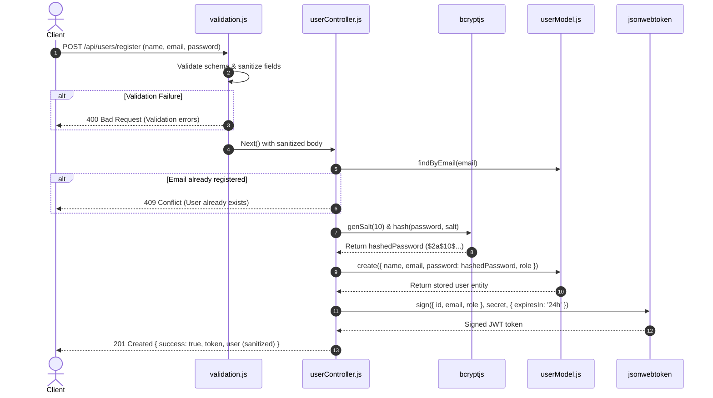
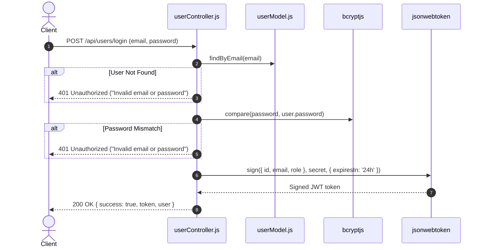
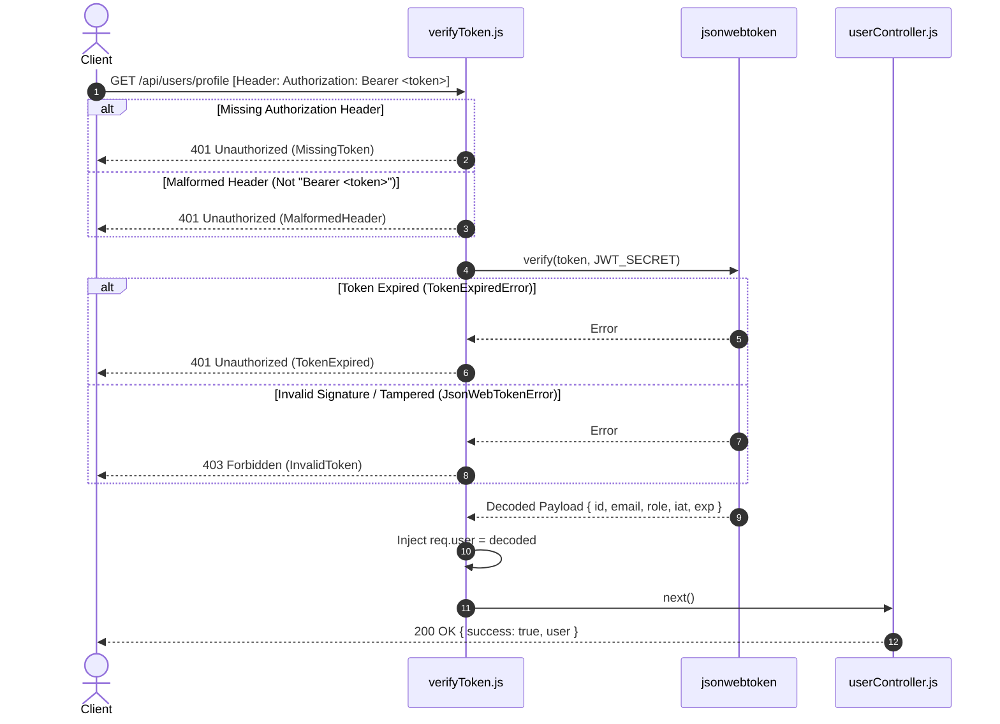

# User Authentication with JSON Web Tokens (JWT) & Express

[](https://nodejs.org/)
[](https://expressjs.com/)
[](https://jwt.io/)
[](https://www.npmjs.com/package/bcryptjs)
[](https://jestjs.io/)

A production-grade, secure authentication service built with **Express.js**, **JSON Web Tokens (JWT)**, and **bcrypt** password hashing. This repository implements user registration, credential authentication, token issuance with explicit expiration, token verification guards, and input sanitization.

---

## 📌 Table of Contents
1. [Overview](#-overview)
2. [Authentication Architecture & Workflow](#-authentication-architecture--workflow)
3. [Security Implementation Details](#-security-implementation-details)
4. [Project Structure](#-project-structure)
5. [API Contracts & Endpoints](#-api-contracts--endpoints)
6. [Environment Configuration](#-environment-configuration)
7. [Installation & Quickstart](#-installation--quickstart)
8. [Automated Test Suite & Evidence](#-automated-test-suite--evidence)
9. [Postman Collection Guide](#-postman-collection-guide)
10. [Interactive Browser Dashboard](#-interactive-browser-dashboard)

---

## 📖 Overview

This service provides end-to-end user identity management and access control:
- **Password Salting & Hashing**: Uses `bcryptjs` to generate cryptographically secure salts and hashes before persisting credentials.
- **Signed JWT Generation**: Creates signed JWTs signed with HMAC SHA-256 (`HS256`) containing user identity claims (`id`, `email`, `role`, `name`) and explicit expiration timestamps (`24h`).
- **Token Verification Guard**: Protects downstream routes using Express middleware (`verifyToken.js`) that validates the `Authorization: Bearer <token>` header, handles expired or tampered signatures, and injects user identity into `req.user`.
- **Payload Validation & Sanitization**: Protects against malformed inputs, email formatting errors, and short passwords.
- **Interactive UI & Automated Tests**: Includes a built-in dark glassmorphic browser dashboard and 17 automated integration tests with Jest & Supertest.

---

## 🔄 Authentication Architecture & Workflow

### 1. Registration & Password Hashing Workflow


### 2. Login & Credential Verification Workflow


### 3. Protected Route & Token Verification Guard


---

## 🔒 Security Implementation Details

| Security Layer | Implementation | Purpose & Benefit |
| :--- | :--- | :--- |
| **Password Hashing** | `bcryptjs` with configurable salt rounds (default: 10) | Prevents rainbow table attacks, slow-hash prevents brute-force. |
| **Token Signing** | `jsonwebtoken.sign(payload, secret, { expiresIn })` | Cryptographically asserts user identity using HMAC SHA-256. |
| **Explicit Expiration** | `expiresIn: '24h'` (or custom from `.env`) | Mitigates risks associated with leaked or stolen access tokens. |
| **Bearer Scheme Guard** | `src/middleware/verifyToken.js` | Enforces standard HTTP `Bearer` token specification. |
| **Error Classification** | Differentiates `TokenExpired` vs `InvalidToken` vs `MissingToken` | Clear client recovery pathways without leaking internal stack traces. |
| **Data Sanitization** | `userModel.sanitize(user)` | Excludes `password` hash from all API responses and queries. |
| **Safe Error Reporting** | Uniform 401 for bad credentials | Prevents user account enumeration. |

---

## 📁 Project Structure

```
week6-task1/
├── .env.example                  # Template configuration parameters
├── .env                          # Local environment variables
├── .gitignore                    # Git ignore file
├── package.json                  # Dependencies & scripts
├── postman_collection.json       # Ready-to-import Postman test collection
├── README.md                     # Architecture & API documentation
├── public/                       # Interactive browser dashboard
│   ├── app.js                    # Client-side testing & JWT decoder
│   ├── index.html                # Dark glassmorphic user interface
│   └── style.css                 # Modern CSS styles and layout
├── src/
│   ├── app.js                    # Express app configuration & middlewares
│   ├── server.js                 # HTTP server listener
│   ├── controllers/
│   │   └── userController.js     # User registration, login & token logic
│   ├── middleware/
│   │   ├── validation.js         # Request body validation & sanitization
│   │   └── verifyToken.js        # Bearer token verification guard
│   ├── models/
│   │   └── userModel.js          # In-memory user data store & sanitization
│   └── routes/
│       └── userRoutes.js         # Authentication routes configuration
└── tests/
    └── auth.test.js              # 17 automated unit and integration tests
```

---

## 📡 API Contracts & Endpoints

Base URL: `http://localhost:5000`

### Summary of Routes
| Method | Endpoint | Access | Purpose |
| :--- | :--- | :--- | :--- |
| `POST` | `/api/users/register` | **Public** | Register new user, hash password, return JWT |
| `POST` | `/api/users/login` | **Public** | Authenticate credentials & return JWT |
| `GET` | `/api/users/verify` | **Protected** | Validate token & return active claims |
| `GET` | `/api/users/profile` | **Protected** | Retrieve profile of authenticated user |
| `GET` | `/api/health` | **Public** | Health probe for monitoring |
| `GET` | `/api` | **Public** | API route catalog |

---

### Endpoint Details

#### 1. Register User
`POST /api/users/register`
- **Request Headers**: `Content-Type: application/json`
- **Request Body**:
```json
{
  "name": "Alex Morgan",
  "email": "alex@example.com",
  "password": "SecurePassword123!",
  "role": "student"
}
```
- **Response `201 Created`**:
```json
{
  "success": true,
  "message": "User registered successfully.",
  "token": "eyJhbGciOiJIUzI1NiIsInR5cCI6IkpXVCJ9...",
  "user": {
    "id": "7f09d0db-bcf5-4e2e-8aa4-47b74e899cb4",
    "name": "Alex Morgan",
    "email": "alex@example.com",
    "role": "student",
    "createdAt": "2026-10-20T16:45:00.000Z",
    "updatedAt": "2026-10-20T16:45:00.000Z"
  }
}
```
- **Error Responses**:
  - `400 Bad Request`: Validation failure (empty field, invalid email, password < 6 chars).
  - `409 Conflict`: User already exists with the provided email.

---

#### 2. User Login
`POST /api/users/login`
- **Request Headers**: `Content-Type: application/json`
- **Request Body**:
```json
{
  "email": "alex@example.com",
  "password": "SecurePassword123!"
}
```
- **Response `200 OK`**:
```json
{
  "success": true,
  "message": "Authentication successful.",
  "token": "eyJhbGciOiJIUzI1NiIsInR5cCI6IkpXVCJ9...",
  "user": {
    "id": "7f09d0db-bcf5-4e2e-8aa4-47b74e899cb4",
    "name": "Alex Morgan",
    "email": "alex@example.com",
    "role": "student"
  }
}
```
- **Error Responses**:
  - `401 Unauthorized`: `"Invalid email or password."`

---

#### 3. Token Verification
`GET /api/users/verify`
- **Request Headers**: `Authorization: Bearer <token>`
- **Response `200 OK`**:
```json
{
  "success": true,
  "message": "Token is valid and active.",
  "user": {
    "id": "7f09d0db-bcf5-4e2e-8aa4-47b74e899cb4",
    "email": "alex@example.com",
    "role": "student",
    "name": "Alex Morgan"
  }
}
```
- **Error Responses**:
  - `401 Unauthorized`: Missing token, malformed header, or expired token.
  - `403 Forbidden`: Invalid or tampered token signature.

---

#### 4. Protected User Profile
`GET /api/users/profile`
- **Request Headers**: `Authorization: Bearer <token>`
- **Response `200 OK`**:
```json
{
  "success": true,
  "message": "User profile retrieved successfully.",
  "user": {
    "id": "7f09d0db-bcf5-4e2e-8aa4-47b74e899cb4",
    "name": "Alex Morgan",
    "email": "alex@example.com",
    "role": "student",
    "createdAt": "2026-10-20T16:45:00.000Z",
    "updatedAt": "2026-10-20T16:45:00.000Z"
  }
}
```

---

## ⚙️ Environment Configuration

Create a `.env` file in the project root by copying `.env.example`:

```bash
cp .env.example .env
```

| Variable | Description | Default Value |
| :--- | :--- | :--- |
| `PORT` | HTTP listener port for Express | `5000` |
| `NODE_ENV` | Runtime environment (`development`, `test`, `production`) | `development` |
| `JWT_SECRET` | Secret key used to sign and verify HMAC SHA-256 tokens | `super_secret_jwt_key_...` |
| `JWT_EXPIRES_IN` | Token validity duration | `24h` |
| `BCRYPT_SALT_ROUNDS` | Cost factor for password hashing salt generation | `10` |

---

## 🚀 Installation & Quickstart

### 1. Install Dependencies
```bash
npm install
```

### 2. Run the Development Server
```bash
npm run dev
```

### 3. Run in Production Mode
```bash
npm start
```
The server will start listening at `http://localhost:5000`. You can visit `http://localhost:5000` directly in your browser to access the visual testing console.

---

## 🧪 Automated Test Suite & Evidence

The project includes automated integration tests utilizing **Jest** and **Supertest** covering 100% of the requirements.

### Run Tests
```bash
npm test
```

### Test Suite Execution Output
```text
PASS tests/auth.test.js
  JWT User Authentication & Security Test Suite
    POST /api/users/register
      √ should successfully register a new user and return a signed JWT token (399 ms)
      √ should reject registration if email is already registered (133 ms)
      √ should reject registration with invalid email format (28 ms)
      √ should reject registration with password shorter than 6 characters (23 ms)
      √ should reject registration with missing name (12 ms)
    POST /api/users/login
      √ should successfully log in with valid credentials and return a JWT (226 ms)
      √ should reject login with incorrect password (196 ms)
      √ should reject login for non-existent email (133 ms)
      √ should reject login when required fields are missing (109 ms)
    Protected Routes & Token Verification Middleware
      √ should access protected profile with a valid Bearer token (130 ms)
      √ should verify token status on GET /api/users/verify (156 ms)
      √ should deny access when Authorization header is missing (401) (116 ms)
      √ should deny access when Authorization header does not use Bearer scheme (401) (116 ms)
      √ should deny access when token is invalid or tampered (403) (114 ms)
      √ should gracefully reject expired tokens with 401 and TokenExpired error (143 ms)
    General Endpoints
      √ should return health status on /api/health (13 ms)
      √ should return 404 for non-existent API routes (12 ms)

Test Suites: 1 passed, 1 total
Tests:       17 passed, 17 total
Snapshots:   0 total
Time:        3.912 s
Ran all test suites.
```

---

## 📮 Postman Collection Guide

A pre-configured Postman collection is included in [`postman_collection.json`](./postman_collection.json).

### How to Import and Run:
1. Open **Postman**.
2. Click **Import** (top left) and select `postman_collection.json`.
3. The collection is configured with variables:
   - `baseUrl`: `http://localhost:5000`
   - `authToken`: Automatically populated via test scripts upon successful Registration or Login.
4. Run requests in sequential order:
   - `1. Health Check`
   - `2. Register New User` (automatically saves `authToken`)
   - `3. Register Duplicate User` (verifies 409 Conflict)
   - `4. Login User` (updates `authToken`)
   - `5. Login With Invalid Password` (verifies 401 Unauthorized)
   - `6. Verify Token` (verifies 200 OK with Bearer token)
   - `7. Get User Profile` (verifies 200 OK)
   - `8. Access Without Token` (verifies 401 MissingToken)
   - `9. Access With Invalid Token` (verifies 403 InvalidToken)

---

## 🖥️ Interactive Browser Dashboard

For ease of inspection, the server automatically hosts an interactive dashboard at `http://localhost:5000`:
- **Live User Registration & Login**: Interactive forms with quick mock-data generation.
- **JWT Token Inspector**: Displays the active token, decomposes claims (`id`, `email`, `role`, `exp`), and calculates real-time validity.
- **One-Click Security Tests**: Test protected endpoints, test missing header (401), or test tampered signature (403) with a single click.
- **Live Response Inspector**: Shows HTTP status pills, response time latency in milliseconds, and formatted JSON bodies.
- **Automated Check Runner**: Runs an automated 4-step sanity check right inside the browser window.

---

## 🛡️ License
MIT License. Developed for Student Placement Tracker Web Development Track.
